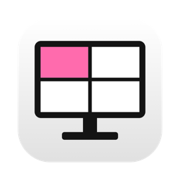

<p align="center"></p>

# Video Grid

Video Grid plays multiple videos side by side in one Mac window. Each tile is its own VLC-powered player with its own playlist. You choose the grid (2×2, 3×2, 3×3, or your own pattern with bigger and smaller tiles), then drag videos in.

It handles anything VLC can play (MKV, MP4, MOV, AVI, WebM, TS, and many more), and videos never resize the window.

## Features

### Layouts
- **Pick a layout on launch:** 2×2, 3×2 (3 across, 2 down), 3×3, or a custom pattern.
- **Custom patterns:** separate rows with `/`. Each `O` is its own video, and a repeated letter makes one bigger video:

  | Pattern | Result |
  |---|---|
  | `XOO/XOO` | one tall video on the left, four small ones on the right |
  | `XXO/XXO/OOO` | one large video plus five small ones |
  | `XX/OO` | one wide video on top, two below |
  | `OOOO/OOOO/OOOO/OOOO` | 4×4, sixteen videos |

- **Switch layouts any time** from the Layout menu. Every tile keeps its videos.
- **Move any tile into the big slot** with ⌘1.
- **Maximize one tile** to fill the window with ⌘Return, and press Esc to go back.

### Resizing
- **Drag the line between two videos** to resize them. Only the tiles touching that line change size, so dragging a line in the top row leaves the bottom row alone.
- **⌥-drag** moves the whole line across every row or column.
- **Double-click a line** to even out the two sides. *Layout → Reset Tile Sizes* restores everything.

### Playback for each tile
- Play/pause, previous/next, and a seek bar.
- **Playlist** per tile: drop files or whole folders on it, reorder by dragging, and double-click to play. Tiles open on their playlist so you can fill them right away.
- **Repeat** (off, all, or one) and **random**.
- **A-B loop:** set two points and the tile loops between them. Click the button to type exact times.
- Volume and mute for each tile.

### Zoom and pan
- **Box zoom:** drag a rectangle over part of a video and that area fills the tile.
- **Other zoom controls:** pinch, scroll wheel, or ⌘-scroll to zoom toward the pointer.
- **Pan** by dragging or two-finger scrolling when zoomed in.
- **Reset** with a double-click or `0`.
- **Zoom follows the tile's shape**, so a tall tile shows a tall slice of a wide video.

### File browser sidebar
- **Folder list:** a Finder-style list of your folders and videos. Start from Movies, Downloads, Desktop, an external drive, or any folder you choose.
- **Drag** videos onto any tile or its playlist, or **double-click** one to play it on the selected tile.
- **Right-click** a video for **Play on Screen ▸** or **Add to Screen's Playlist ▸**. While that menu is open, every tile shows its screen number in large type, and the one you point at lights up.
- **Placement:** put the sidebar on the left or the right, drag its edge to resize it, or hide it with ⌃⌘S or the title-bar button.

### Whole-window keys
| Key | Action |
|---|---|
| **Space** | Play/pause the selected tile, or every tile if none is selected |
| **Return** | Play/pause every tile, whatever is selected |
| **Right Shift** (tap) | Mute/unmute every tile |
| **Esc** | Deselect the tile (or leave a maximized tile) |
| ⌥⌘P / ⌥⌘R / ⌥⌘S / ⌥⌘M | Play/pause all, restart all, stop all, mute all |
| ⌥⌘4 / ⌥⌘6 / ⌥⌘9 | Switch to 2×2 / 3×2 / 3×3 |
| ⇧⌘L | Custom layout |
| ⌘O | Add files to the selected tile |

*Help → Video Grid Shortcuts* lists every key.

### Command line
Skip the layout picker and start playing right away:

```bash
"/Applications/Video Grid.app/Contents/MacOS/VideoGrid" --layout XOO/XOO --play a.mp4 b.mkv c.mov
```

## Requirements

- macOS 14 Sonoma or later
- A Mac with Apple silicon (M1 or later)

## Install

Download **Video Grid.dmg** from [Releases](https://github.com/labalicious/videogrid/releases), open it, and drag **Video Grid** to Applications. It is signed and notarized by Apple, so it opens without security warnings.

## Build from source

You need the Xcode Command Line Tools (`xcode-select --install`) and [VLC](https://www.videolan.org/vlc/) installed in `/Applications`. Full Xcode isn't needed.

```bash
./build.sh            # builds build/Video Grid.app
./build.sh install    # also copies it to ~/Applications
./build.sh dist       # signs, notarizes, and makes build/Video Grid.dmg
```

The build copies libVLC and its plugins out of VLC.app into the bundle, so the app runs on its own and later VLC updates can't break it. Re-run the build to pick up a newer libVLC.

`./build.sh dist` needs a **Developer ID Application** certificate (from developer.apple.com → Certificates) and saved notarization credentials:

```bash
xcrun notarytool store-credentials videogrid-notary --apple-id YOUR_APPLE_ID --team-id YOUR_TEAM_ID
```

`SIGN_ID=- ./build.sh dist` tests the signing and packaging steps without a certificate.

The app icon is drawn in code by `Tools/make-icon.swift`. Run `swift Tools/make-icon.swift` to regenerate `Resources/AppIcon.icns`.

## How it's built

The app is written in Swift and AppKit and talks to libVLC 3 through its C API. There's no Xcode project; `build.sh` compiles with `swiftc`.

| File | What it does |
|---|---|
| `Sources/Player.swift` | One libVLC player with its playlist, repeat, random, and A-B loop. Blocking libVLC calls run off the main thread. |
| `Sources/VideoView.swift` | Zoom and pan, done by cropping the source picture in VLC. |
| `Sources/TileView.swift`, `PlaylistView.swift` | Per-tile controls, the playlist, and the A-B popover. |
| `Sources/LayoutTree.swift` | Turns a pattern like `XOO/XOO` into nested splits so each dividing line drags on its own. |
| `Sources/GridWindowController.swift` | The grid, its draggable lines, the sidebar, and the window-wide keys. |
| `Sources/FileBrowserView.swift` | The file browser sidebar and its Play on Screen menu. |
| `Sources/LayoutPicker.swift`, `Support.swift` | The layout picker and pattern parsing. |
| `Sources/DebugHarness.swift` | Test-only (`DEBUG=1 ./build.sh`): drives the app and saves pictures of the window. |

## Credits

Playback is by [libVLC](https://www.videolan.org/vlc/libvlc.html) from VideoLAN. libVLC and its plugins are licensed under the LGPL/GPL, and their source code is available at [videolan.org](https://www.videolan.org).
